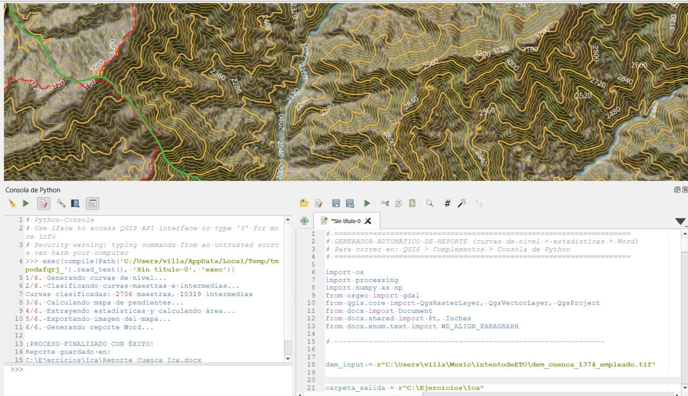

# Curvas de nivel y reporte automático del relieve

Proyecto de aprendizaje aplicado a la cuenca del río Ica. El archivo Python conservado automatiza operaciones de QGIS mediante PyQGIS, GDAL, NumPy y python-docx.

## Qué produce

- Curvas de nivel cada 40 m con un atributo TIPO_CURVA. Cada múltiplo de 200 m se clasifica como Maestra y las demás curvas como Intermedia.
- Un ráster de pendientes en grados.
- Estadísticas de elevación absoluta y percentiles 1 y 99, además de pendiente media y máxima.
- Área de los píxeles válidos del DEM en m², hectáreas y km².
- Una imagen del lienzo activo de QGIS y un reporte Word con tablas y esa imagen.

La [publicación del autor](evidencia/publicacion.png) registra extremos de −2 y 4654 m y percentiles de 158 y 4411 m. La captura de ejecución registra 2706 entidades maestras y 10319 intermedias. Son cifras documentadas de aquella ejecución. Los conteos corresponden a entidades de línea, que pueden incluir varios segmentos a una misma elevación.

## Cómo ejecutarlo

1. Abre tu proyecto en QGIS y prepara el DEM recortado al área de interés, con elevaciones en metros y un CRS proyectado en metros, como EPSG:32718 para Ica.
2. Comprueba que el entorno Python de QGIS dispone de NumPy, GDAL y python-docx. El módulo de importación de python-docx se llama docx. Si falta, la ejecución mostrará ModuleNotFoundError.
3. Abre **Complementos → Consola de Python → Mostrar editor** y carga [reporte_dem_qgis.py](reporte_dem_qgis.py).
4. Ajusta intervalo_curvas y factor_maestra en la sección de configuración si lo necesitas. Prepara la extensión y las capas visibles del mapa que quieres incluir en el reporte.
5. Ejecuta el archivo y selecciona el DEM y la carpeta de resultados en las ventanas que aparecen. Se crea una subcarpeta nueva por ejecución.

La salida incluye curvas_nivel.shp y sus archivos asociados, slope.tif, vista_mapa.png y Reporte_DEM.docx. Conserva juntos los componentes del shapefile.

## Alcance del archivo conservado

El DEM entra ya preparado. El recorte de cuenca y la visualización con Qgis2threejs mencionados en la publicación son etapas complementarias. El código incluye el campo de clasificación de curvas y utiliza un símbolo rojo único para representarlas. La simbología amarilla observada en la captura puede corresponder a ajustes realizados en QGIS.

Los percentiles describen el rango central del 98 % de las elevaciones válidas. El cálculo conserva el DEM original. La causa de los valores extremos requiere inspección espacial y contraste con otra información antes de atribuirlos a ruido. El área reportada corresponde a la cobertura válida del DEM. Su correspondencia con la cuenca depende de la máscara usada al prepararlo.

El mapa del Word refleja el lienzo activo de QGIS. Las estadísticas se calculan sobre el DEM seleccionado. Hay que preparar una vista coherente con ese DEM antes de ejecutar.

Este ejercicio usa datos globales y conserva el alcance académico declarado en la publicación. Una aplicación de diseño o construcción requiere validación topográfica adecuada.

## Adaptación para compartir

Esta versión parte del archivo Python entregado por el autor. Se sustituyeron las rutas personales por ventanas de selección, se añadieron comprobaciones de CRS y datos válidos, y se guarda cada ejecución en una subcarpeta nueva. Se precisó el texto del reporte sobre percentiles y cobertura del DEM.

La sintaxis de la versión adaptada fue comprobada. Su ejecución completa dentro de QGIS y el Word resultante quedan pendientes de verificar. La captura corresponde a la ejecución histórica.

## Referencias técnicas

- [Algoritmos de extracción y curvas de nivel de QGIS](https://docs.qgis.org/3.40/en/docs/user_manual/processing_algs/gdal/rasterextraction.html)
- [Pendientes y unidades en GDAL](https://gdal.org/en/stable/programs/gdaldem.html)
